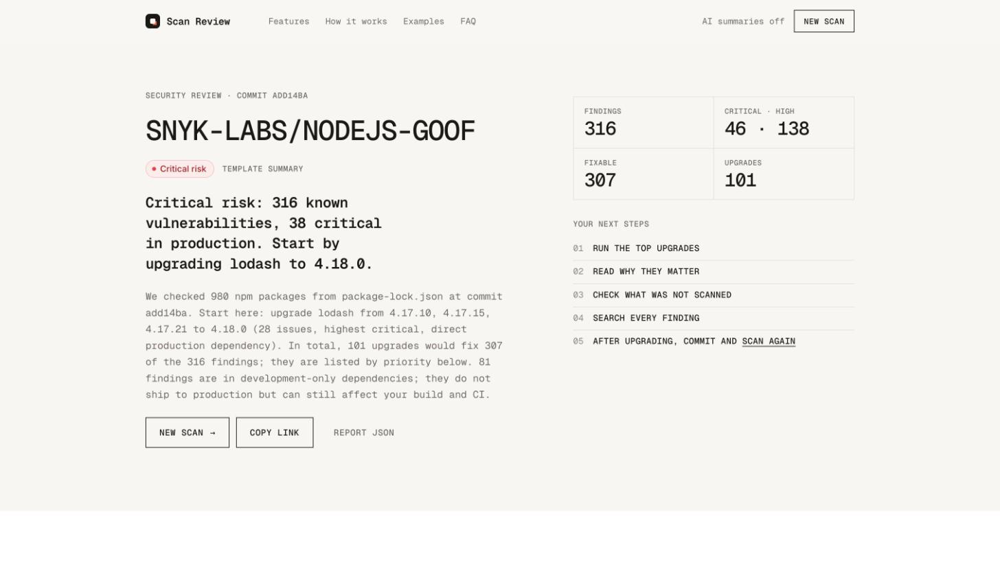
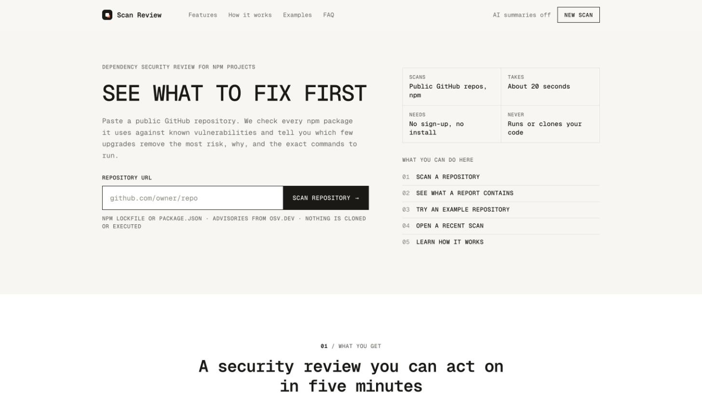
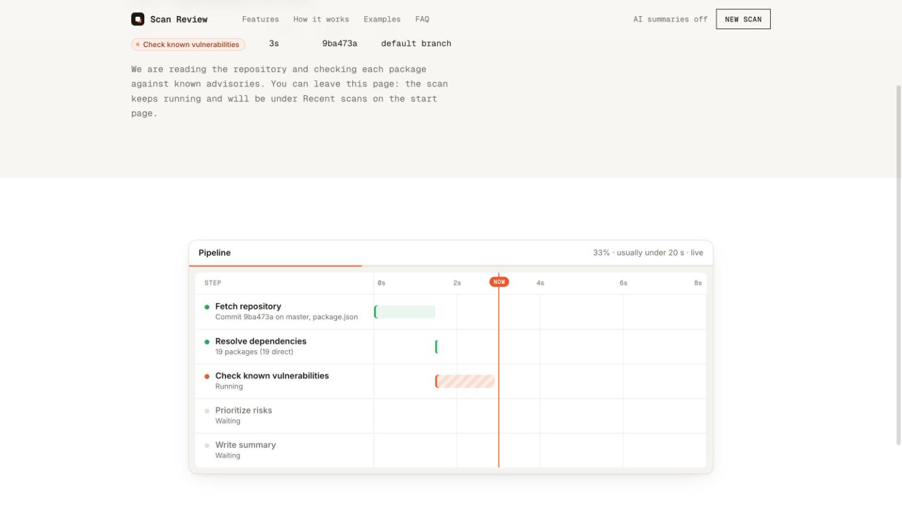
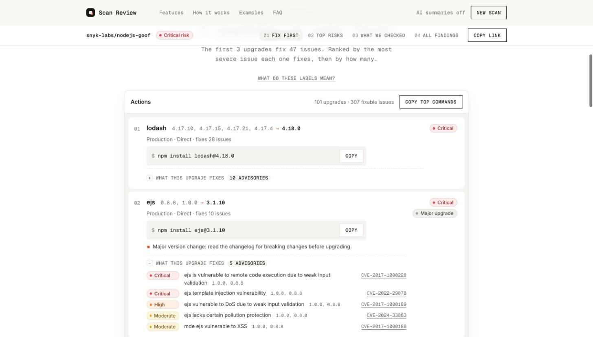

# Scan Review: AI-assisted dependency security review

Paste a public GitHub repository URL. Scan Review reads its npm dependencies at a pinned commit, checks every package version against known vulnerabilities (OSV.dev), and answers the question the customer actually asked: **what matters, what is risky, and what should I do next.**

The answer is a short, ranked list of **upgrades** (not a list of CVEs), each with the exact command to run, a plain-language explanation of the top risks, and an honest statement of what was and was not checked.



---

## Quick start (1 minute)

Requirements: Node 22 (see `.nvmrc`) and npm 10 or newer.

```bash
npm install
npm run dev                      # live mode: real GitHub + OSV.dev, no keys needed
# or
SCANNER_MODE=mock npm run dev    # fully offline demo with recorded fixtures
```

Open **http://localhost:5180**. The API listens on **http://localhost:8787** (the web dev server proxies `/api`).

Or with Docker, the production image (API and web on one origin, no Node needed):

```bash
docker compose up --build                     # offline demo on http://localhost:8787
SCANNER_MODE=live docker compose up --build   # real scans; keys are read from .env if present
```

Optional, in a `.env` file at the repository root (copy `.env.example`):

| Variable            | Why you may want it                                                                                                                                          |
| ------------------- | ------------------------------------------------------------------------------------------------------------------------------------------------------------ |
| `GITHUB_TOKEN`      | Recommended. Without it, GitHub allows 60 API requests per hour, which is about 12 to 15 scans. A fine-grained token with public read-only access is enough. |
| `ANTHROPIC_API_KEY` | Turns on AI-written summaries (`ANTHROPIC_MODEL`, default `claude-sonnet-5-5`). Without it, a deterministic template writes them, and the report says so.    |

Good repositories to try in live mode: `OWASP/NodeGoat`, `snyk-labs/nodejs-goof` (lockfiles with many known issues), `expressjs/express` (no lockfile, so the result is marked approximate). In mock mode the start page offers four demo repositories, including one that fails on purpose.

API only:

```bash
curl -s -X POST localhost:8787/api/scans -H 'content-type: application/json' \
  -d '{"repoUrl":"https://github.com/OWASP/NodeGoat"}'
curl -s localhost:8787/api/scans/<scanId>          # status and steps
curl -sN localhost:8787/api/scans/<scanId>/events  # live progress (SSE)
curl -s localhost:8787/api/scans/<scanId>/report   # the report
```

---

## The product

### How I read the request

The customer does not lack data; every scanner prints hundreds of advisories. They lack a **decision**: which few things to do this week, and why. So the product is judged on how fast a repo owner goes from a URL to "I know the 1 to 3 upgrades that remove most of my risk". Full interpretation, personas and user stories: [`docs/BRD.md`](docs/BRD.md).

### Three ideas the design is built on

1. **Actions, not findings.** Findings are grouped by the upgrade that fixes them: _"Upgrade lodash 4.17.15 to 4.18.0: fixes 6 issues (highest: high) in a direct production dependency."_ The report leads with these actions; the full findings table comes last.
2. **Deterministic ranking; AI only explains.** Severity, scores, ranking, commands and the risk level come from data and a documented formula. The LLM writes the headline and explanations from the already-ranked results, and its output is schema-validated and checked against the findings. If it is missing, fails or invents anything, a template is used, and the report shows which one wrote the summary.
3. **Honest coverage.** Every report states the commit, which manifest was used, whether versions are exact (lockfile) or approximate (`package.json` ranges), how many packages were checked, and what was not scanned. A clean result is never mistaken for "not scanned".

### The flow

| Start                                | Live progress                              | Report: Fix first                            |
| ------------------------------------ | ------------------------------------------ | -------------------------------------------- |
|  |  |  |

1. **Submit a URL.** Validated in the browser and again on the server (`https://github.com/{owner}/{repo}`, optional `.git` or `/tree/{ref}`).
2. **Start a scan.** `POST /api/scans` returns immediately; an identical in-flight scan is reused.
3. **Follow progress.** Five pipeline steps drawn as a live timeline from real step timings (Server-Sent Events, with polling as a fallback). Failures explain themselves and offer "Scan again" when retrying can help.
4. **Read the result,** in this order: risk level and headline with "your next steps"; **Fix first** (ranked upgrades, copyable commands, what each upgrade fixes, a legend for every label); **top risks explained**; **what we checked**; **every finding**, searchable and filterable. Copy a link, the top commands, or the JSON.
5. **Act.** Run the commands, commit, scan again.

---

## Architecture

```
apps/web (React)  ──REST + SSE──▶  apps/api (Fastify)
                                     ├─ ScanService       submit, dedupe, admission control
                                     ├─ JobQueue          in-process, 2 concurrent, 25 queued
                                     ├─ ScanOrchestrator  drives the state machine, emits events
                                     ├─ domain/           pure: severity, CVSS, fix versions, scoring,
                                     │                    actions, risk, template summary, LLM validation
                                     └─ integrations/     GitHub REST, npm lockfile resolver,
                                                          OSV.dev, Anthropic (+ template fallback)
packages/shared (Zod) = the API contract, used by both sides
```

- State machine: `queued → fetching_repo → resolving_dependencies → checking_vulnerabilities → prioritizing → generating_summary → completed`, with `failed` reachable from any non-terminal state; transitions are enforced in code.
- Every integration is behind an interface. Postgres and BullMQ/Redis are the documented production choices for the store and the queue.
- Details, diagrams, the data model and the scoring formula with worked examples: [`docs/ARCHITECTURE.md`](docs/ARCHITECTURE.md). Every endpoint: [`docs/API.md`](docs/API.md).

### Prioritization in one paragraph

Each finding scores `severity weight × (production 1.0 | development 0.3) × (direct 1.0 | transitive 0.75) × (fix available 1.0 | none 0.8)`. Findings are grouped by package; the target version is the lowest version that fixes every fixable finding in the group. An action ranks by its single most dangerous finding, and the number of issues only breaks ties, so many small issues never outrank one critical (that rule came from a real ranking bug, see ADR-018). The risk level is rule-based: any critical in production is `critical`, and so on (ARCHITECTURE §5.4).

---

## Product and technical decisions

Short ADRs are in [`docs/DECISIONS.md`](docs/DECISIONS.md). The ones worth knowing first:

| Decision                                           | Why                                                                                                                                             |
| -------------------------------------------------- | ----------------------------------------------------------------------------------------------------------------------------------------------- |
| OSV.dev instead of `npm audit` or Snyk             | Free, keyless, documented batch API; includes the GitHub Advisory Database and malicious-package feed; covers the ecosystems we would add next. |
| GitHub REST API instead of cloning                 | We need two files at one commit. No clone means no attacker-controlled files on disk and no code execution, ever.                               |
| SSE with polling fallback                          | Progress is one-way and low-frequency; SSE is plain HTTP and reconnects by itself.                                                              |
| Fastify, Zod everywhere, a shared contract package | Built-in logging with redaction, `inject()` tests, and one schema source for API and browser.                                                   |
| In-memory store and queue behind interfaces        | A 3-hour scope; the production path is documented.                                                                                              |
| No worker threads; cache and parallelize I/O       | Measured: under 60 ms CPU per scan against 11-20 s of network wait. The time went where it is spent (ADR-020, ADR-022).                         |
| Structured LLM output, not a forced tool call      | `claude-sonnet-5-5` rejects forced `tool_choice`; the JSON schema pins `findingId` to the real IDs, and our own validator still runs.           |

Deliberate deviations from the brief, each with a reason:

- **In-flight dedupe** is keyed on `owner/repo#ref` at submit time, because the commit SHA is not known without calling GitHub, and the submit endpoint does no outbound I/O. Completed results are then reused by commit SHA for an hour (ADR-009).
- **OSV `querybatch` is retried** although it is a POST: it is a read-only query, and not retrying it would fail a whole scan on one transient 503 (ADR-010).

---

## Security

The service takes an untrusted URL, reads untrusted content and sends some of it to an LLM, so each step is treated as an attack surface. Full STRIDE-lite threat model: [`docs/SECURITY.md`](docs/SECURITY.md).

- **SSRF:** only `https://github.com/{owner}/{repo}` is accepted, parsed with `URL`, with owner and repo names checked against GitHub's rules and dot segments rejected. The user's URL is never fetched; requests go to fixed `api.github.com` and `api.osv.dev` origins, and redirects are followed only within the same origin.
- **Untrusted repository content:** no clone, install or execution. 10 MB cap enforced while streaming, a package-count cap, safe JSON parsing (no prototype pollution through package keys), name and version validation.
- **Prompt injection:** the LLM gets only structured, length-capped fields (no file contents, no advisory details or links) with a system prompt that treats them as data. Output is schema-validated and rejected if it references advisories or `package@version` strings that are not in the findings, or contains links.
- **Rendering:** plain text only; an ESLint rule bans `dangerouslySetInnerHTML`.
- **Abuse:** per-IP rate limits, 16 KB bodies, bounded queue (503 when full), 120 s scan timeout, per-call timeouts, SSE connection caps and heartbeats.
- **Secrets:** env only, validated at startup, redacted from logs, never sent to the browser.
- **HTTP:** helmet with a strict CSP, CORS limited to the web origin, sanitized `X-Request-Id`.
- **Independent review before submission:** a separate adversarial security review and a correctness review were run over the whole codebase; all 13 findings (including a quadratic lockfile-parsing DoS and two prompt-injection gaps) were reproduced, fixed and covered by regression tests. The list is in [`docs/AI_USAGE.md`](docs/AI_USAGE.md).
- **This project's supply chain:** exact pins, committed lockfile, `npm audit` in CI, a two-week cooldown on new releases, minimal runtime dependencies ([`docs/DEPENDENCIES.md`](docs/DEPENDENCIES.md)). Two patched releases were taken early because advisories appeared for the pinned versions (fastify, and zod mid-assessment).

---

## Reliability and performance

- **Measured first.** Step timings from live scans showed the work is network-bound: advisory hydration was about 80% of a scan, parsing and scoring under 60 ms. Numbers and reasoning: [`ARCHITECTURE.md` section 11](docs/ARCHITECTURE.md#11-performance-measured).
- **Advisory cache across scans,** validated against the `modified` timestamp OSV already returns, so it is never stale for a changed advisory (ADR-020). Hydration parallelism doubled to 16.
- **Errors are layered:** typed `ScanFailure` codes with fixed messages, one HTTP error envelope, leak-free 500s with a request ID, partial failures that degrade the report with a note, and a React error boundary so a rendering bug is never a blank page.
- **Process lifecycle:** graceful SIGTERM shutdown that ends every running and queued scan with a retryable `SERVER_SHUTTING_DOWN` code and tells open SSE clients; fatal logging and a non-zero exit on unhandled rejections; a 10 s hard stop (ADR-021).

---

## Deployment

- **Image:** a multi-stage `Dockerfile` (Node 22 Alpine pinned by digest, production dependencies only, non-root, read-only filesystem friendly, `HEALTHCHECK`). The API serves the built web app, so the whole product is one container and one URL (ADR-023).
- **Render:** `render.yaml` is a Blueprint for one Docker web service: live mode, health check on `/api/health`, two trusted proxy hops (edge and internal load balancer, verified from logs) for correct client IPs, and a lower per-client scan quota. `GITHUB_TOKEN` and `ANTHROPIC_API_KEY` are entered in the Render dashboard, never committed. Deploys run on every push to `main`.
- **CI** builds the image and checks it end to end: healthy, non-root, both CSPs, and a clean exit on `docker stop`.
- At scale: API replicas from the same image behind a load balancer, the web build on a CDN, and Postgres, BullMQ and Redis in place of the in-process store, queue and cache ([`ARCHITECTURE.md` sections 10 and 12](docs/ARCHITECTURE.md#12-deployment)).

---

## Testing

```bash
npm run typecheck   # strict TS in all workspaces
npm run lint        # typescript-eslint strict-type-checked + react-hooks
npm test            # 289 unit and integration tests: 221 API, 57 shared, 11 web
npm run test:e2e    # Playwright smoke tests in a real browser (offline mock mode, own ports)
```

Run `npx playwright install chromium` once before the first `test:e2e`.

- **Domain:** unit tests for the URL parser (including SSRF-style inputs), state machine, CVSS calculator, severity rules, fixed-version selection, the scoring examples from the docs, grouping, risk level, the template summary and the LLM output validator.
- **Integrations:** the real GitHub and OSV clients run against recorded fixtures through an injected `fetch` (status mapping, retries, redirects, size caps, malformed responses). The LLM client runs against a fake SDK client (refusal, truncation, invalid JSON, invented advisories, API errors).
- **API:** `fastify.inject` covers the happy path, invalid URL, repo and ref not found, no manifest, GitHub rate limit and outage, OSV failure, LLM failure falling back to the template, timeout, degraded advisories, dedupe, same-commit reuse, the advisory cache, validation errors, rate limiting, security headers, the global error handler (unmapped 4xx, leak-free 500) and graceful shutdown (scans and SSE streams end with a retryable code, requests get a 503 envelope). SSE is tested over a real socket.
- **End to end:** Playwright starts its own API and web servers in mock mode and checks the main journey (scan from URL, progress, report, Fix first, findings search), URL validation, and a failed scan explaining itself.
- Tests are offline and deterministic. Fixtures were recorded from the live OSV API with `npx tsx apps/api/scripts/record-osv-fixtures.ts`.

---

## Known limitations

- Public GitHub repositories only, npm only, repository root only. Lockfile v1, `yarn.lock` and `pnpm-lock.yaml` fall back to `package.json` (approximate).
- No authentication; scans are readable by anyone who has the (random) ID. In-memory store: a restart loses scans.
- Without `GITHUB_TOKEN`, about 12 to 15 scans per hour for the whole server. Each client may start at most `SCANS_PER_HOUR` (default 30) new scans per hour, so one client cannot use up a token's quota; re-opening or duplicating a scan is free.
- Without a lockfile the risk level is labelled "estimated": each dependency is checked at the lowest version its range allows, which can flag issues the installed version does not have.
- No reachability analysis: a vulnerable function may never be called by your code.
- For a transitive dependency the command is `npm update <pkg>` when the fix is in the same major version, and an `overrides` entry (`npm pkg set "overrides[pkg]=x.y.z" && npm install`) when it needs a new major, because `npm update` never crosses a major. Forcing a new major on a parent can break it; the report says so. We do not compute which parent version would fix it.
- The AI summary path is covered by tests with a fake client and was verified live against `claude-sonnet-5-5` (NodeGoat: grounded headline and overview accepted by the validator, about 8 s). It depends on the configured model being available to your API key; otherwise the template summary is used.

## What I'd do next

- **SAST** for first-party code (Semgrep), shown in the same "actions" format.
- **Exploit signals:** EPSS and CISA KEV to rank actively exploited issues first.
- **Reachability analysis** to downgrade vulnerabilities in code paths that are never called.
- **GitHub App with OAuth:** private repositories, org-wide installs, and pull-request comments or automated upgrade PRs.
- **More ecosystems:** `requirements.txt`/`poetry.lock`, `go.mod`, yarn and pnpm lockfiles, monorepo subfolders (the resolver interface is ready).
- **Report before the AI summary:** complete the report with the template summary immediately and stream the AI summary in when it arrives, so the report never waits on the model (about 8 s today).
- **Production infrastructure:** Postgres store, BullMQ/Redis queue and pub/sub for multi-instance SSE, the advisory cache on Redis, and policy checks ("no criticals in production") for CI.

---

## How I used coding agents

The project was built with Claude Code from a detailed brief I wrote that fixed the product direction, stack, phases and engineering rules. Documentation came first (requirements, architecture, API, threat model, decisions), then implementation milestone by milestone with typecheck, lint and tests as a gate, then several rounds of review in a real browser against live repositories.

[`docs/AI_USAGE.md`](docs/AI_USAGE.md) is the factual log: what was generated, where the agent was wrong and how it was caught (for example a URL-parser path-traversal case, a ranking rule that put 25 high issues above a critical, a stale fixed-version assumption for lodash, a zod advisory found by a fresh-clone check), and how each change was verified. My own review notes are at the end of that file.

## Repository layout

```
apps/api            Fastify API: domain/ (pure logic), integrations/, scans/, http/
apps/api/fixtures   Recorded GitHub-shaped repos and OSV responses
apps/web            React app: screens/, components/, hooks/, api/
packages/shared     Zod schemas (API contract) and the GitHub URL parser
docs/               BRD, ARCHITECTURE, API, SECURITY, DECISIONS, DEPENDENCIES, AI_USAGE
CLAUDE.md           Conventions for coding-agent sessions
```

## Data attribution

Vulnerability data comes from [OSV.dev](https://osv.dev). The recorded fixtures in `apps/api/fixtures/osv` are OSV records sourced from the [GitHub Advisory Database](https://github.com/github/advisory-database), licensed under [CC-BY 4.0](https://creativecommons.org/licenses/by/4.0/).
