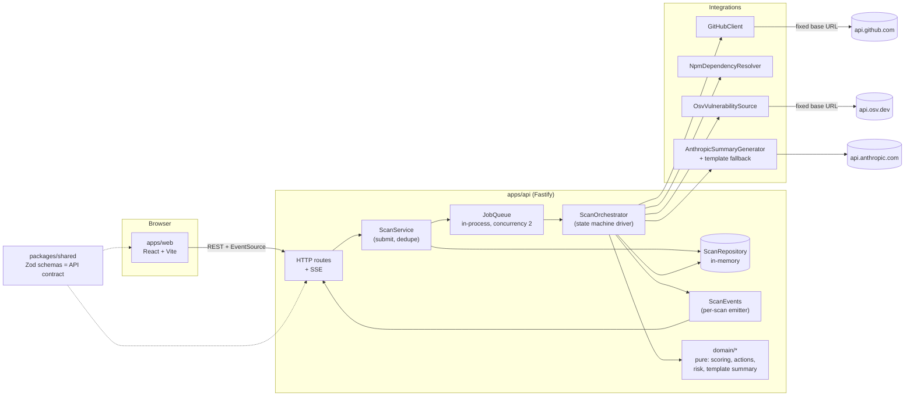
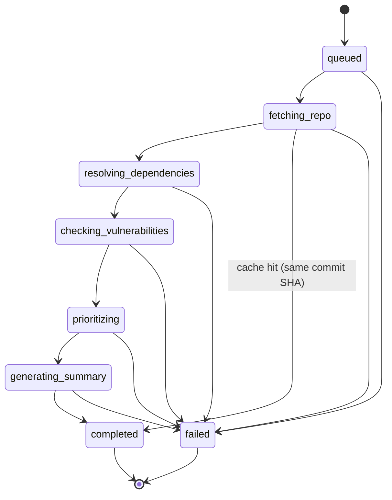
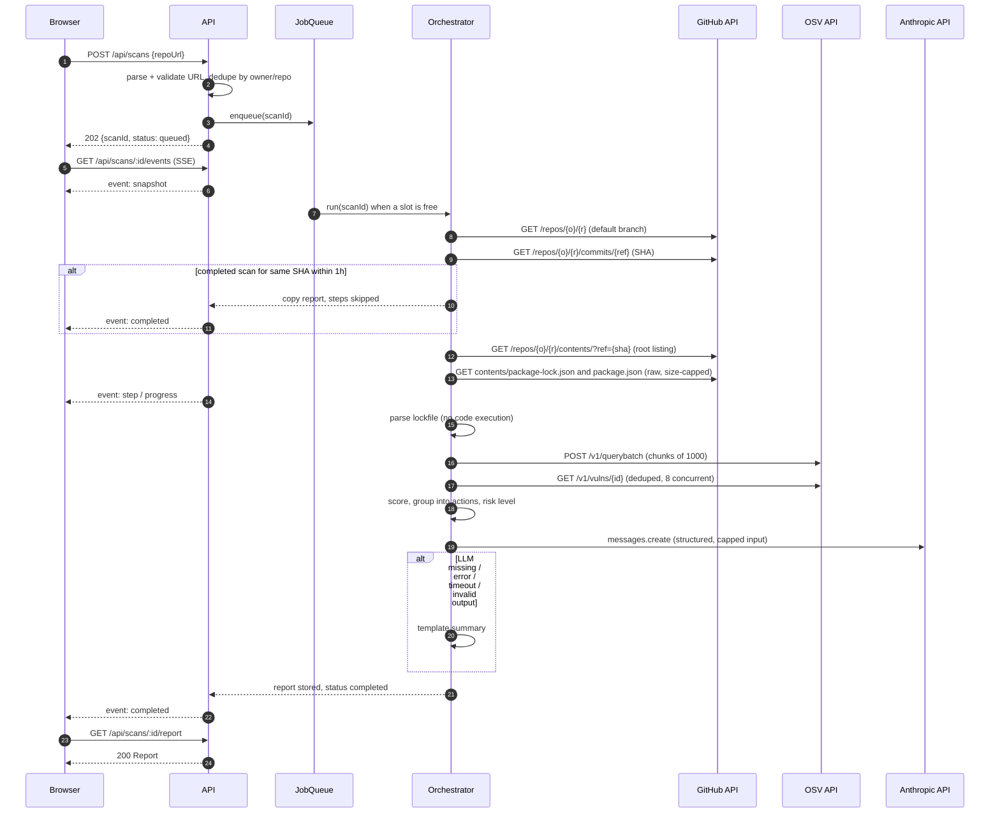

# Architecture

## 1. Components



Every integration is an interface with two implementations: a live one and a fixture-backed mock (`SCANNER_MODE=mock`). The container (`apps/api/src/container.ts`) picks them at startup. The domain layer (`apps/api/src/domain`) imports no framework, performs no I/O and is unit-tested in isolation.

## 2. Scan state machine



Allowed transitions (enforced by `assertTransition` in `apps/api/src/domain/stateMachine.ts`; any other transition throws and is a bug):

| From | To |
|---|---|
| `queued` | `fetching_repo`, `failed` |
| `fetching_repo` | `resolving_dependencies`, `completed` (cache hit only), `failed` |
| `resolving_dependencies` | `checking_vulnerabilities`, `failed` |
| `checking_vulnerabilities` | `prioritizing`, `failed` |
| `prioritizing` | `generating_summary`, `failed` |
| `generating_summary` | `completed`, `failed` |
| `completed`, `failed` | none (terminal) |

Each working state has a matching `ScanStep`. Step status is one of `pending`, `running`, `completed`, `skipped`, `failed`. On a cache hit, the remaining steps are marked `skipped`. Progress is `round(100 * finishedSteps / 6)` where finished means `completed` or `skipped`; a completed scan is always 100.

`generating_summary` can never fail the scan because of the LLM: the summary generator falls back to the template internally. It only fails on a programming error.

## 3. Sequence of a full scan



## 4. Data model

All of these are Zod schemas in `packages/shared/src`; the TypeScript types are `z.infer` of them. Abbreviated:

```ts
Scan {
  id: uuid
  repo: { owner, name, url }        // url is canonical https://github.com/owner/name
  ref: string | null                // as requested; null = default branch
  commitSha: string | null          // known after fetching_repo
  status: ScanStatus
  progress: 0..100
  steps: ScanStep[]                 // always 6, in order
  error: ScanError | null
  createdAt, updatedAt: ISO string
  finishedAt: ISO string | null
}
ScanStep  { name: StepName, label, status: StepStatus, detail: string | null, startedAt, finishedAt }
ScanError { code: ScanErrorCode, message: string, retryable: boolean }

Dependency {                        // internal (api), not in the public contract
  name, version, direct: boolean, dev: boolean, introducedBy: string[]
}
Finding {
  id                                // OSV id, e.g. GHSA-p6mc-m468-83gw
  aliases: string[]                 // e.g. CVE-2020-8203
  packageName, installedVersion
  severity: CRITICAL | HIGH | MODERATE | LOW | UNKNOWN
  severitySource: malicious | ghsa | cvss_v3 | unknown
  cvssScore: number | null
  summary: string                   // capped at 300 chars
  fixedVersion: string | null
  direct, dev: boolean
  introducedBy: string[]            // direct deps that pull this package in (max 3)
  score: number
  advisoryUrl: string               // https://osv.dev/vulnerability/{id}, built by us
}
Action {
  id, packageName
  currentVersions: string[]         // a package can be installed at several versions
  targetVersion: string | null      // null = no patched version exists
  findingIds: string[]
  fixableCount: number              // findings resolved by targetVersion
  highestSeverity, direct, dev, introducedBy
  score: number
  command: string | null            // e.g. npm install lodash@4.17.21
  rationale: string                 // deterministic one-liner
}
Report {
  scanId, repo, commitSha, ref, generatedAt
  riskLevel: critical | high | medium | low | none
  summary: { mode: ai | template, headline, overview, fallbackReason: string | null }
  actions: Action[]                 // sorted by score desc
  topRisks: { findingId, packageName, severity, title, explanation }[]   // <= 5
  findings: Finding[]               // sorted by score desc
  stats: { totalFindings, bySeverity, actionCount, fixableFindings }
  coverage: Coverage
  notes: string[]                   // visible degradations, e.g. "3 advisories could not be loaded"
  reusedFromScanId: uuid | null
}
Coverage {
  ecosystem: npm
  manifest: package-lock.json | package.json
  lockfileVersion: number | null
  accuracy: exact | approximate
  packagesChecked, directDependencies, transitiveDependencies, skippedPackages: number
  unsupportedManifests: string[]    // e.g. requirements.txt, yarn.lock
  scannedPath: "/"
}
```

## 5. Prioritization

### 5.1 Severity (source order)

For each advisory, the first rule that matches wins:

1. **`malicious`**: the OSV ID starts with `MAL-` (OpenSSF malicious-packages feed). Severity `CRITICAL`: a malicious package is a compromise, not a bug.
2. **`ghsa`**: `database_specific.severity` from the GitHub Advisory Database (`CRITICAL`, `HIGH`, `MODERATE`/`MEDIUM`, `LOW`).
3. **`cvss_v3`**: a `CVSS_V3` vector in `severity[]`. We compute the CVSS 3.x base score ourselves (`domain/cvss.ts`) and map it: >= 9.0 critical, >= 7.0 high, >= 4.0 moderate, > 0 low.
4. **`unknown`**: otherwise (including CVSS v4-only advisories, and advisories whose details could not be hydrated).

`UNKNOWN` is never silently dropped or treated as low. It gets a weight between low and moderate, is labelled "Unknown severity: review manually" in the UI, and an unknown-severity production finding raises the risk level to at least `medium`.

### 5.2 Finding score

```
score = severityWeight × scopeFactor × relationshipFactor × fixFactor
```

| Factor | Values | Rationale |
|---|---|---|
| severityWeight | CRITICAL 10, HIGH 7, MODERATE 4, UNKNOWN 3, LOW 1.5 | Roughly tracks CVSS bands |
| scopeFactor | production 1.0, development 0.3 | Dev dependencies do not ship, but build-time compromise is still real, so not 0 |
| relationshipFactor | direct 1.0, transitive 0.75 | Direct deps are more likely to be called with attacker input, and are easier to upgrade |
| fixFactor | fix available 1.0, no fix 0.8 | The report is a to-do list: what you can fix today ranks first. Unfixable items stay visible with mitigation advice |

A package installed both as a dev and as a production dependency counts as production. A package that is both direct and transitive counts as direct.

Worked examples:

| Finding | Calculation | Score |
|---|---|---|
| CRITICAL, production, direct, fix available | 10 × 1.0 × 1.0 × 1.0 | **10.0** |
| HIGH, production, transitive, fix available | 7 × 1.0 × 0.75 × 1.0 | **5.25** |
| CRITICAL, dev, direct, fix available | 10 × 0.3 × 1.0 × 1.0 | **3.0** |
| MODERATE, production, transitive, no fix | 4 × 1.0 × 0.75 × 0.8 | **2.4** |
| LOW, dev, transitive, fix available | 1.5 × 0.3 × 0.75 × 1.0 | **0.34** |

The third row is the point of the formula: a critical in a test-only tool ranks below a high in a production transitive dependency.

### 5.3 Grouping findings into actions

1. Group findings by `packageName` (all installed versions of that package together).
2. For each finding, compute the **minimal fixed version for the installed version**: walk the advisory's `SEMVER` ranges for that package and take the `fixed` event that closes the range containing the installed version.
3. `targetVersion` = the highest of those fixed versions (semver order), so one upgrade fixes every fixable finding in the group. `null` if none is fixable.
4. `fixableCount` = findings with a fixed version. Findings without one stay in the group and the rationale says so.
5. `score` = max(finding scores) + 0.25 × sum(other finding scores), rounded to two decimals. One critical dominates; many smaller issues still lift an action.
6. `command`:
   - direct production: `npm install pkg@target`
   - direct dev: `npm install --save-dev pkg@target`
   - transitive: `npm update pkg`, with the rationale noting the direct parents and that an `overrides` entry is needed if the parent pins an older range
   - no fix: `null`, rationale suggests replacing the package or mitigating
7. Sort actions by score, then by package name.

Example: lodash 4.17.15 (transitive via `express-validator`, production) with 6 advisories, the highest HIGH, all fixed by 4.17.21 or lower: one action "Upgrade lodash 4.17.15 to 4.17.21: fixes 6 issues (highest: high) in a production dependency".

### 5.4 Risk level

Evaluated top-down, first match wins:

| Level | Rule |
|---|---|
| `critical` | any CRITICAL finding in a production dependency |
| `high` | any HIGH in production, or any CRITICAL in development |
| `medium` | any MODERATE or UNKNOWN in production, or any HIGH in development |
| `low` | any other finding |
| `none` | no findings |

### 5.5 Top risks

The top 5 findings by score, **at most one per package** (so five lodash advisories do not crowd out everything else). These are what the summary explains.

## 6. Idempotency and caching

- **In-flight dedupe at submit time:** key `owner/repo#ref` (lower-cased owner and repo; ref or `HEAD`). If a non-terminal scan exists for the key, `POST /api/scans` returns `200` with that scan's ID and `deduplicated: true`. The commit SHA is not known at submit time without calling GitHub, and we keep outbound I/O off the request path (see `DECISIONS.md` ADR-009).
- **Result cache by commit SHA:** after `fetching_repo` resolves the SHA, if a completed scan for `owner/repo@sha` finished within the last hour, its report is copied to the new scan (`reusedFromScanId` is set), the remaining steps are marked `skipped`, and the scan completes immediately.

## 7. Timeouts, retries, limits

| Concern | Value | Where |
|---|---|---|
| Whole scan | 120 s (`SCAN_TIMEOUT_MS`), an `AbortSignal` passed to every call | Orchestrator |
| GitHub request | 10 s | `HttpGitHubClient` |
| OSV request | 15 s | `OsvVulnerabilitySource` |
| LLM request | 20 s (`LLM_TIMEOUT_MS`), SDK retries disabled | `AnthropicSummaryGenerator` |
| Retries | 2 retries (3 attempts), backoff `300ms × 2^n` + up to 100 ms jitter; `Retry-After` honoured up to 5 s. Only on network errors, 5xx, and 429 | `lib/http.ts` |
| Which calls retry | GitHub GETs, OSV `GET /v1/vulns/{id}`, and OSV `POST /v1/querybatch` (a read-only query; see ADR-010) | |
| Not retried | 4xx other than 429, GitHub rate-limit 403 (reset is minutes away), LLM calls (fallback instead) | |
| Manifest size | 10 MB, enforced while streaming the body, not after | `lib/http.ts` `readBodyCapped` |
| Packages | 10,000 unique `name@version` | Resolver |
| Advisories hydrated | 500 per scan; the rest become `UNKNOWN` with a note | OSV source |
| Request body | 16 KB | Fastify `bodyLimit` |
| Queue | 2 concurrent scans, 25 pending; above that `503 SERVICE_BUSY` | `InProcessJobQueue` |
| Stored scans | Most recent 200; oldest terminal scans evicted | `InMemoryScanRepository` |

## 8. Error handling pattern

- Integrations throw `ScanFailure(code, message?)` for known conditions (for example GitHub 404 becomes `REPO_NOT_FOUND`). Each code has a fixed human message and a `retryable` flag in `domain/errors.ts`.
- The orchestrator catches everything. A `ScanFailure` becomes `scan.error`; anything else is logged with the stack and becomes `INTERNAL_ERROR` with a generic message.
- HTTP handlers throw `AppError(httpStatus, code, message, details?)`. A single Fastify error handler maps `AppError`, Zod errors, Fastify's own errors (body too large, rate limit) and unknown errors to `{ error: { code, message, details? } }`. Stacks are never sent.
- Partial failures (hydration, LLM) never throw past their integration; they return data plus a note.

## 9. Scaling in production

| Today | Production |
|---|---|
| In-memory `ScanRepository` | Postgres: `scans`, `scan_steps`, `reports (jsonb)`; unique partial index on `(owner, repo, ref) WHERE status NOT IN ('completed','failed')` gives dedupe across instances |
| In-process `JobQueue` | BullMQ on Redis, with separate worker deployments, job-level timeout, retries with backoff, dead-letter queue |
| Per-process event emitter | Redis pub/sub (or Postgres `LISTEN/NOTIFY`) so any API instance can serve any scan's SSE stream |
| Per-scan OSV lookups | A shared cache of `name@version -> advisory IDs` and `id -> advisory` with a TTL; most packages repeat across repos |
| One GitHub token | GitHub App installation tokens per customer org (5,000 req/h each) |
| Rate limit in memory | `@fastify/rate-limit` with the Redis store |
| Single LLM call per scan | Same, plus caching by `(commitSha, findings hash)` |

The domain layer, the integration interfaces and the API contract do not change in any of these moves.
