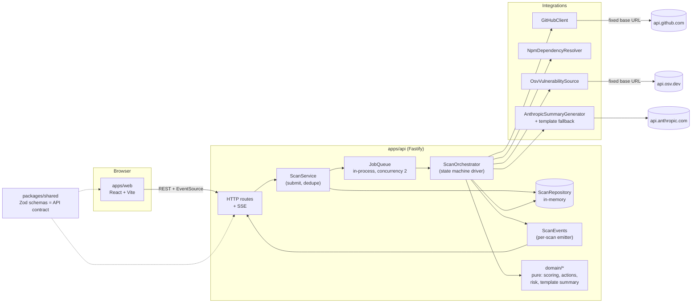
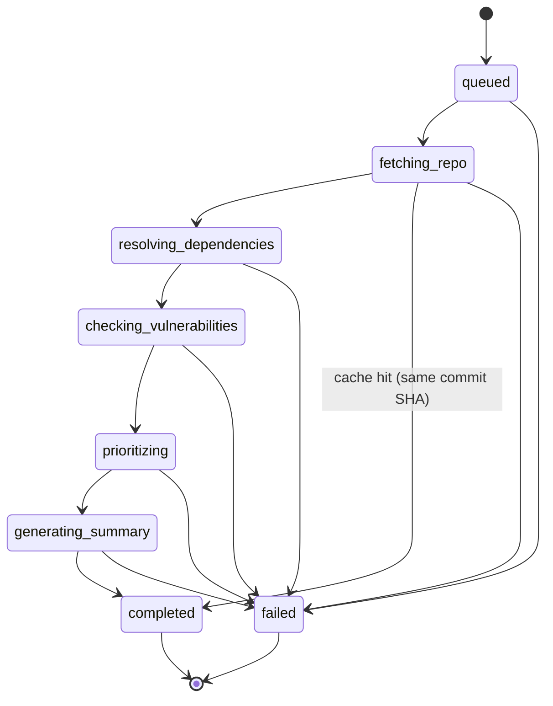
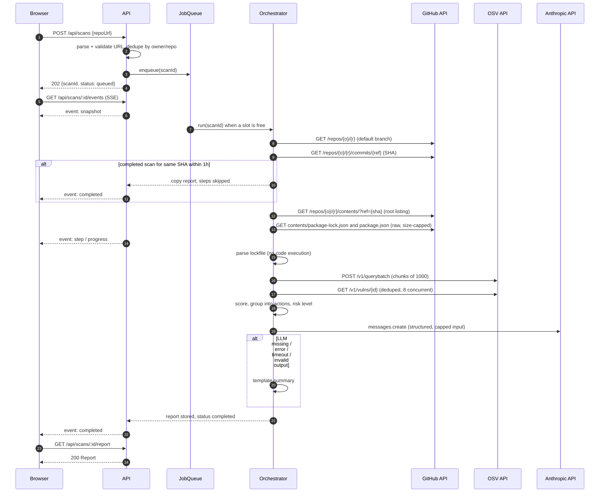

# Architecture

## 1. Components



Every integration is an interface. The live GitHub and OSV clients take an injectable `fetch`: `SCANNER_MODE=mock` and the tests inject `createFixtureFetch`, which serves recorded responses from `apps/api/fixtures`, so the same parsing and error-mapping code runs offline (ADR-016). The container (`apps/api/src/container.ts`) wires everything at startup and is the only place that knows the mode. The domain layer (`apps/api/src/domain`) imports no framework, performs no I/O and is unit-tested in isolation.

## 2. Scan state machine



Allowed transitions (enforced by `assertTransition` in `apps/api/src/domain/stateMachine.ts`; any other transition throws and is a bug):

| From                       | To                                                               |
| -------------------------- | ---------------------------------------------------------------- |
| `queued`                   | `fetching_repo`, `failed`                                        |
| `fetching_repo`            | `resolving_dependencies`, `completed` (cache hit only), `failed` |
| `resolving_dependencies`   | `checking_vulnerabilities`, `failed`                             |
| `checking_vulnerabilities` | `prioritizing`, `failed`                                         |
| `prioritizing`             | `generating_summary`, `failed`                                   |
| `generating_summary`       | `completed`, `failed`                                            |
| `completed`, `failed`      | none (terminal)                                                  |

Each working state has a matching `ScanStep`. Step status is one of `pending`, `running`, `completed`, `skipped`, `failed`. On a cache hit, the remaining steps are marked `skipped`. Progress is `round(100 * finishedSteps / 6)` where finished means `completed` or `skipped`; a completed scan is always 100.

`generating_summary` can never fail the scan because of the LLM: the summary generator falls back to the template internally. It only fails on a programming error.

## 3. Sequence of a full scan



## 4. Data model

All of these are Zod schemas in `packages/shared/src`; the TypeScript types are `z.infer` of them. Abbreviated:

```ts
Scan {
  id: uuid
  repo: { owner, name, url }        // url is canonical https://github.com/owner/name
  ref: string | null                // as requested; null = default branch
  commitSha: string | null          // known after fetching_repo
  status: ScanStatus
  progress: 0..100
  steps: ScanStep[]                 // always 6, in order
  error: ScanError | null
  createdAt, updatedAt: ISO string
  finishedAt: ISO string | null
}
ScanStep  { name: StepName, label, status: StepStatus, detail: string | null, startedAt, finishedAt }
ScanError { code: ScanErrorCode, message: string, retryable: boolean }

Dependency {                        // internal (api), not in the public contract
  name, version, direct: boolean, dev: boolean, introducedBy: string[]
}
Finding {
  id                                // OSV id, e.g. GHSA-p6mc-m468-83gw
  aliases: string[]                 // e.g. CVE-2020-8203
  packageName, installedVersion
  severity: CRITICAL | HIGH | MODERATE | LOW | UNKNOWN
  severitySource: malicious | ghsa | cvss_v3 | unknown
  cvssScore: number | null
  summary: string                   // capped at 300 chars
  fixedVersion: string | null
  direct, dev: boolean
  introducedBy: string[]            // direct deps that pull this package in (max 3)
  score: number
  advisoryUrl: string               // https://osv.dev/vulnerability/{id}, built by us
}
Action {
  id, packageName
  currentVersions: string[]         // a package can be installed at several versions
  targetVersion: string | null      // null = no patched version exists
  majorUpgrade: boolean             // target is a higher major version than an installed one
  findingIds: string[]
  fixableCount: number              // findings resolved by targetVersion
  highestSeverity, direct, dev, introducedBy
  score: number                     // = highest finding score (ADR-018)
  command: string | null            // e.g. npm install lodash@4.18.0
  rationale: string                 // deterministic one-liner (API consumers; the UI shows only the extra advice)
}
Report {
  scanId, repo, commitSha, ref, generatedAt
  riskLevel: critical | high | medium | low | none
  summary: { mode: ai | template, headline, overview, fallbackReason: string | null }
  actions: Action[]                 // sorted by score desc
  topRisks: { findingId, packageName, severity, title, explanation }[]   // <= 5
  findings: Finding[]               // sorted by score desc
  stats: { totalFindings, bySeverity, actionCount, fixableFindings }
  coverage: Coverage
  notes: string[]                   // visible degradations, e.g. "3 advisories could not be loaded"
  reusedFromScanId: uuid | null
}
Coverage {
  ecosystem: npm
  manifest: package-lock.json | package.json
  lockfileVersion: number | null
  accuracy: exact | approximate
  packagesChecked, directDependencies, transitiveDependencies, skippedPackages: number
  unsupportedManifests: string[]    // e.g. requirements.txt, yarn.lock
  scannedPath: "/"
}
```

## 5. Prioritization

### 5.1 Severity (source order)

For each advisory, the first rule that matches wins:

1. **`malicious`**: the OSV ID starts with `MAL-` (OpenSSF malicious-packages feed). Severity `CRITICAL`: a malicious package is a compromise, not a bug.
2. **`ghsa`**: `database_specific.severity` from the GitHub Advisory Database (`CRITICAL`, `HIGH`, `MODERATE`/`MEDIUM`, `LOW`).
3. **`cvss_v3`**: a `CVSS_V3` vector in `severity[]`. We compute the CVSS 3.x base score ourselves (`domain/cvss.ts`) and map it: >= 9.0 critical, >= 7.0 high, >= 4.0 moderate, > 0 low.
4. **`unknown`**: otherwise (including CVSS v4-only advisories, and advisories whose details could not be hydrated).

`UNKNOWN` is never silently dropped or treated as low. It gets a weight between low and moderate, is labelled "Unknown severity: review manually" in the UI, and an unknown-severity production finding raises the risk level to at least `medium`.

### 5.2 Finding score

```
score = severityWeight × scopeFactor × relationshipFactor × fixFactor
```

| Factor             | Values                                              | Rationale                                                                                                           |
| ------------------ | --------------------------------------------------- | ------------------------------------------------------------------------------------------------------------------- |
| severityWeight     | CRITICAL 10, HIGH 7, MODERATE 4, UNKNOWN 3, LOW 1.5 | Roughly tracks CVSS bands                                                                                           |
| scopeFactor        | production 1.0, development 0.3                     | Dev dependencies do not ship, but build-time compromise is still real, so not 0                                     |
| relationshipFactor | direct 1.0, transitive 0.75                         | Direct deps are more likely to be called with attacker input, and are easier to upgrade                             |
| fixFactor          | fix available 1.0, no fix 0.8                       | The report is a to-do list: what you can fix today ranks first. Unfixable items stay visible with mitigation advice |

A package installed both as a dev and as a production dependency counts as production. A package that is both direct and transitive counts as direct.

Worked examples:

| Finding                                     | Calculation            | Score    |
| ------------------------------------------- | ---------------------- | -------- |
| CRITICAL, production, direct, fix available | 10 × 1.0 × 1.0 × 1.0   | **10.0** |
| HIGH, production, transitive, fix available | 7 × 1.0 × 0.75 × 1.0   | **5.25** |
| CRITICAL, dev, direct, fix available        | 10 × 0.3 × 1.0 × 1.0   | **3.0**  |
| MODERATE, production, transitive, no fix    | 4 × 1.0 × 0.75 × 0.8   | **2.4**  |
| LOW, dev, transitive, fix available         | 1.5 × 0.3 × 0.75 × 1.0 | **0.34** |

The third row is the point of the formula: a critical in a test-only tool ranks below a high in a production transitive dependency.

### 5.3 Grouping findings into actions

1. Group findings by `packageName` (all installed versions of that package together).
2. For each finding, compute the **minimal fixed version for the installed version**: walk the advisory's `SEMVER` ranges for that package and take the `fixed` event that closes the range containing the installed version.
3. `targetVersion` = the highest of those fixed versions (semver order), so one upgrade fixes every fixable finding in the group. `null` if none is fixable.
4. `fixableCount` = findings with a fixed version. Findings without one stay in the group and the rationale says so.
5. `score` = the highest finding score in the group. An action is as urgent as its most dangerous finding; volume never outranks severity. (An earlier draft added 0.25 × the other scores; on real data that ranked axios, with 25 high/moderate issues, above a critical in production. See `DECISIONS.md` ADR-018.)
6. `command`:
   - direct production: `npm install pkg@target`
   - direct dev: `npm install --save-dev pkg@target`
   - transitive, fix in the same major: `npm update pkg` (stays inside the parent's range); the rationale names the direct parents and mentions `overrides` if a parent pins an older range
   - transitive, fix needs a new major: `npm pkg set "overrides[pkg]=target" && npm install`, because `npm update` never crosses a major version; the report warns that parents expecting the old major may break
   - a package that is direct but also nested under another package keeps `introducedBy`, and the rationale says the nested copy needs an `overrides` entry
   - no fix: `null`, rationale suggests replacing the package or mitigating
7. Sort actions by score, then by number of fixable findings, then by number of findings, then by package name.

Example (from the recorded fixtures): lodash 4.17.15, a direct production dependency, has 6 advisories, the highest HIGH. Four are fixed by 4.17.21 or lower, two only by 4.18.0, so the action is "Upgrade lodash 4.17.15 to 4.18.0: fixes 6 issues (highest: high) in a direct production dependency". Upgrading to the commonly quoted 4.17.21 would leave two open.

### 5.4 Risk level

Evaluated top-down, first match wins:

| Level      | Rule                                                              |
| ---------- | ----------------------------------------------------------------- |
| `critical` | any CRITICAL finding in a production dependency                   |
| `high`     | any HIGH in production, or any CRITICAL in development            |
| `medium`   | any MODERATE or UNKNOWN in production, or any HIGH in development |
| `low`      | any other finding                                                 |
| `none`     | no findings                                                       |

When no lockfile was used (`coverage.accuracy` is `approximate`), the UI badge and the template headline label the level "estimated", because versions were inferred from `package.json` ranges.

### 5.5 Top risks

The top 5 findings by score, **at most one per package** (so five lodash advisories do not crowd out everything else). These are what the summary explains.

### 5.6 Other risks (supply chain and hygiene)

`domain/otherRisks.ts` turns `ManifestFacts` into at most one entry per kind. The facts are collected by the resolver during the parse it already does (no second pass over a large lockfile, no extra network calls): per installed package its `resolved` URL, `hasInstallScript` and `license`; the declared specifiers of the root and workspace packages; and the root `engines.node`.

| Kind                  | Rule                                                                                              | Level                                  |
| --------------------- | ------------------------------------------------------------------------------------------------- | -------------------------------------- |
| `insecure-download`   | `resolved` starts with `http://`                                                                  | high                                   |
| `non-registry-source` | a declared git, GitHub-shorthand or URL specifier, or a git `resolved` (local `file:` is ignored) | high if any is production, else medium |
| `install-scripts`     | `hasInstallScript: true`                                                                          | medium                                 |
| `no-lockfile`         | only `package.json` was found                                                                     | medium                                 |
| `unpinned-range`      | a dist-tag (`latest`) or a range with no upper bound (`*`, `x`, `>=1`)                            | medium in production, else low         |
| `unsupported-node`    | `engines.node` does not intersect `SUPPORTED_NODE_RANGE` (`>=22` as of 2026-10-26)                | medium                                 |
| `copyleft-license`    | a production package's SPDX licence is GPL, AGPL or SSPL, unless the expression offers `OR`       | medium                                 |
| `duplicate-versions`  | one package installed in 3 or more versions                                                       | low                                    |

These are ranked separately from vulnerability findings and never change the risk level: a licence or an install script is a different kind of risk from a known exploit, and mixing them would make the ranking harder to trust. The LLM does not see or write them.

## 6. Idempotency and caching

- **In-flight dedupe at submit time:** key `owner/repo#ref` (lower-cased owner and repo; ref or `HEAD`). If a non-terminal scan exists for the key, `POST /api/scans` returns `200` with that scan's ID and `deduplicated: true`. The commit SHA is not known at submit time without calling GitHub, and we keep outbound I/O off the request path (see `DECISIONS.md` ADR-009).
- **Result cache by commit SHA:** after `fetching_repo` resolves the SHA, if a completed scan for `owner/repo@sha` finished within the last hour, its report is copied to the new scan (`reusedFromScanId` is set), the remaining steps are marked `skipped`, and the scan completes immediately.
- **Advisory cache across scans:** hydrated advisories (`GET /v1/vulns/{id}`) are kept in a bounded, process-wide LRU (`AdvisoryCache`, 5,000 entries). `querybatch` already returns each match's `modified` timestamp, so an entry is reused only while OSV reports the same `modified` value: the cache is never stale for advisories that OSV has changed, and needs no TTL in the normal case (6 h if OSV omits `modified`). Failures are not cached, so they are retried by the next scan. Entries are copied on read, so scans cannot affect each other (ADR-020).

## 7. Timeouts, retries, limits

| Concern             | Value                                                                                                                                       | Where                          |
| ------------------- | ------------------------------------------------------------------------------------------------------------------------------------------- | ------------------------------ |
| Whole scan          | 120 s (`SCAN_TIMEOUT_MS`), an `AbortSignal` passed to every call                                                                            | Orchestrator                   |
| GitHub request      | 10 s                                                                                                                                        | `HttpGitHubClient`             |
| OSV request         | 15 s                                                                                                                                        | `OsvVulnerabilitySource`       |
| LLM request         | 20 s (`LLM_TIMEOUT_MS`), SDK retries disabled                                                                                               | `AnthropicSummaryGenerator`    |
| Retries             | 2 retries (3 attempts), backoff `300ms × 2^n` + up to 100 ms jitter; `Retry-After` honoured up to 5 s. Only on network errors, 5xx, and 429 | `lib/http.ts`                  |
| Which calls retry   | GitHub GETs, OSV `GET /v1/vulns/{id}`, and OSV `POST /v1/querybatch` (a read-only query; see ADR-010)                                       |                                |
| Not retried         | 4xx other than 429, GitHub rate-limit 403 (reset is minutes away), LLM calls (fallback instead)                                             |                                |
| Manifest size       | 10 MB, enforced while streaming the body, not after                                                                                         | `lib/http.ts` `readBodyCapped` |
| Packages            | 10,000 unique `name@version`                                                                                                                | Resolver                       |
| Advisories hydrated | 500 per scan; the rest become `UNKNOWN` with a note                                                                                         | OSV source                     |
| Hydration fan-out   | 16 parallel `GET /v1/vulns/{id}` per scan (network-bound; see section 11)                                                                   | OSV source                     |
| Request body        | 16 KB                                                                                                                                       | Fastify `bodyLimit`            |
| Queue               | 2 concurrent scans, 25 pending; above that `503 SERVICE_BUSY`                                                                               | `InProcessJobQueue`            |
| Scans per client    | `SCANS_PER_HOUR` (default 30) new scans per client per hour; `429 RATE_LIMITED` beyond. Duplicates are free                                 | `ScanQuota`                    |
| Stored scans        | Most recent 200; oldest terminal scans evicted                                                                                              | `InMemoryScanRepository`       |

## 8. Error handling pattern

- Integrations throw `ScanFailure(code, message?)` for known conditions (for example GitHub 404 becomes `REPO_NOT_FOUND`). Each code has a fixed human message and a `retryable` flag in `domain/errors.ts`.
- The orchestrator catches everything. A `ScanFailure` becomes `scan.error`; anything else is logged with the stack and becomes `INTERNAL_ERROR` with a generic message.
- HTTP handlers throw `AppError(httpStatus, code, message, details?)`. A single Fastify error handler maps `AppError`, Zod errors, Fastify's own errors (body too large, rate limit) and unknown errors to `{ error: { code, message, details? } }`. Stacks are never sent.
- Partial failures (hydration, LLM) never throw past their integration; they return data plus a note.
- Any other 4xx raised by the framework keeps its status with the generic `BAD_REQUEST` code; only real server faults become `500 INTERNAL_ERROR`, and only those are logged at error level.
- The job queue's last-resort `catch` logs at `fatal` ("scan job escaped its own error handling"): it can only fire on a bug, so it must never be silent.
- **Process level** (`server.ts`): `unhandledRejection` and `uncaughtException` are logged at `fatal` with context, then the process shuts down gracefully and exits non-zero, so the supervisor restarts a clean process. Continuing after either would run on unknown state.
- **Graceful shutdown** (SIGTERM/SIGINT, `preClose` hook): new requests get `503 SERVICE_BUSY` in the standard envelope; running scans are aborted and queued scans fail on start, all with the retryable `SERVER_SHUTTING_DOWN` code, so no client watches a scan that will never finish; the server waits up to 5 s for them to record that state (open SSE streams receive the `failed` event), closes any streams still open, then stops listening. A 10 s hard timeout forces exit if anything hangs (ADR-021).
- **Web:** a top-level React error boundary, re-keyed per route, turns a rendering bug into a "This page could not be displayed" panel with Try again and Back to start, instead of a blank page. API and scan errors are handled in the screens, with messages from the error codes above.

## 9. Web client

`apps/web` is a React app with no router, state library or UI kit (ADR-015, ADR-019).

| Screen | Route         | What it does                                                                                                                                                                                                                                                                                              |
| ------ | ------------- | --------------------------------------------------------------------------------------------------------------------------------------------------------------------------------------------------------------------------------------------------------------------------------------------------------- |
| Start  | `#/`          | URL form with live validation (shared parser) and a "will scan owner/repo" preview; what a report contains; how a scan works; examples; recent scans; FAQ                                                                                                                                                 |
| Scan   | `#/scans/:id` | While running: the pipeline as a timeline built from step timings, live via `EventSource`, falling back to polling `GET /api/scans/:id` every 1.5 s on stream errors. On failure: the error message and code, and "Scan again" when `retryable`. On completion the same route renders the report in place |
| Report | `#/scans/:id` | Verdict and next steps, Fix first (with what each upgrade fixes, copyable commands, a labels legend), top risks, coverage, searchable findings table; a sticky section bar; copy link and JSON                                                                                                            |

- Every API response is parsed with the shared Zod schemas before use (`src/api/client.ts`); a contract mismatch is shown as an error, not rendered.
- All text, including AI output, is rendered as text; an ESLint rule bans `dangerouslySetInnerHTML`.
- Fonts are self-hosted so the production CSP can stay `'self'`.
- Route changes reset scroll and move focus to `main`; the tab title reflects progress and the risk level.

## 10. Scaling in production

| Today                      | Production                                                                                                                                                                |
| -------------------------- | ------------------------------------------------------------------------------------------------------------------------------------------------------------------------- |
| In-memory `ScanRepository` | Postgres: `scans`, `scan_steps`, `reports (jsonb)`; unique partial index on `(owner, repo, ref) WHERE status NOT IN ('completed','failed')` gives dedupe across instances |
| In-process `JobQueue`      | BullMQ on Redis, with separate worker deployments, job-level timeout, retries with backoff, dead-letter queue                                                             |
| Per-process event emitter  | Redis pub/sub (or Postgres `LISTEN/NOTIFY`) so any API instance can serve any scan's SSE stream                                                                           |
| In-process advisory cache  | The same `AdvisoryCache` shape on Redis, shared by all workers; optionally cache `name@version -> advisory IDs` too, with a short TTL                                     |
| One GitHub token           | GitHub App installation tokens per customer org (5,000 req/h each)                                                                                                        |
| Rate limit in memory       | `@fastify/rate-limit` with the Redis store                                                                                                                                |
| Single LLM call per scan   | Same, plus caching by `(commitSha, findings hash)`                                                                                                                        |

The domain layer, the integration interfaces and the API contract do not change in any of these moves.

## 11. Performance (measured)

Live scans on a laptop, before the advisory cache (times per step from the scan's own step timings):

| Repository              | Packages | Advisories   | Fetch repo | Resolve | OSV (match + hydrate) | Prioritize | AI summary |
| ----------------------- | -------- | ------------ | ---------- | ------- | --------------------- | ---------- | ---------- |
| `snyk-labs/nodejs-goof` | 980      | 225          | 2.2 s      | 25 ms   | 8.8 s                 | 17 ms      | (off)      |
| `OWASP/NodeGoat`        | 1,091    | 317 findings | 2.6 s      | 34 ms   | 9.4 s                 | 23 ms      | 7.8 s      |

After the changes (same machine, same day, live OSV):

| Scan                                          | OSV step before | OSV step after | Why                                     |
| --------------------------------------------- | --------------- | -------------- | --------------------------------------- |
| `OWASP/NodeGoat`, empty cache                 | 9.4 s           | 6.2 s          | Hydration parallelism 8 to 16           |
| `snyk-labs/nodejs-goof`, right after NodeGoat | 8.8 s           | 4.0 s          | Shared advisories served from the cache |
| Same repo and commit again                    | full scan       | instant        | Result reuse by commit SHA (section 6)  |

What this says, and what was done about it:

- **The work is network-bound, not CPU-bound.** Parsing the lockfile, building the graph and scoring take under 60 ms together. Worker threads would not make a scan faster (ADR-022).
- **Advisory hydration dominates.** It is one request per advisory. Two changes: parallelism went from 8 to 16 (about half the cold time), and the cross-scan `AdvisoryCache` removes those requests entirely for advisories seen before, which is most of them across npm projects. A repeat or overlapping scan's OSV step drops to the single `querybatch` call.
- **The LLM is the second largest cost** and is bounded by `LLM_TIMEOUT_MS`; the template summary is used on timeout. Next step (not built): complete the report with the template summary immediately and stream the AI summary in afterwards, so the report never waits on the model.
- **Where CPU could matter:** a very large monorepo lockfile (tens of MB). `JSON.parse` plus the bounded graph walk (`MAX_GRAPH_STEPS`) could hold the event loop for hundreds of milliseconds and stall other clients' SSE. The fix is to run `resolve()` in a `worker_threads` pool (it is already a pure function of strings to data), measured with `monitorEventLoopDelay` first; at real scale, scans run in separate worker processes behind the queue (section 10), which isolates this anyway.

## 12. Deployment

| Piece       | Today                                                                                                                                                            |
| ----------- | ---------------------------------------------------------------------------------------------------------------------------------------------------------------- |
| Image       | `Dockerfile`: build stage compiles shared, API and web; runtime stage has production dependencies, compiled output, fixtures (mock mode) and the web build       |
| Process     | `node apps/api/dist/server.js` as PID 1, user `node`, so SIGTERM reaches the graceful shutdown directly                                                          |
| Origin      | One: `/api/*` is the API, everything else is the web build (`WEB_DIST_DIR`), with separate CSPs                                                                  |
| Health      | `HEALTHCHECK` and Render's health check both use `GET /api/health`                                                                                               |
| Local       | `docker compose up --build` (mock mode by default, read-only filesystem, no capabilities)                                                                        |
| Public demo | Render Blueprint (`render.yaml`): live mode, `TRUST_PROXY_HOPS=3`, `SCANS_PER_HOUR=10`, secrets entered in the dashboard                                         |
| CI          | Builds the image, scans it with Trivy, checks it runs as non-root and turns healthy, checks both CSPs, and checks that `docker stop` exits 0 (graceful shutdown) |

At scale the same image runs as API replicas behind a load balancer, with the web build moved to a CDN and the in-process pieces replaced as in section 10.
